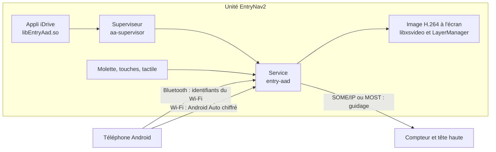

<div align="center">


# EntryNav2 (EntryEvo) Android Auto

**Android Auto dans l'iDrive des BMW équipées d'une unité EntryNav2, sans fil ou par câble USB.**<br>
Sans boîtier, sans remplacer aucun fichier BMW, et mises à jour par clé USB.

[](https://github.com/Jiraiya43/EntryNav2-Android-Auto/actions/workflows/ci.yml)
[](https://github.com/Jiraiya43/EntryNav2-Android-Auto/releases)
[](https://github.com/Jiraiya43/EntryNav2-Android-Auto/releases)
[](LICENSE.md)

[English](README.md) · Français

[Démarrage rapide](#démarrage-rapide) · [Voitures compatibles](#voitures-compatibles) ·
[Guide d'installation](docs/INSTALLATION.md) · [Questions fréquentes](#questions-fréquentes) ·
[Journal des versions](CHANGELOG.md)

</div>

> [!WARNING]
> Logiciel expérimental qui écrit sur le système de la voiture. Il est développé sur **une voiture** ; les
> propriétaires d'une vingtaine d'autres disent ce qu'ils ont vu ([liste](docs/COMPATIBILITE.md)), et rien ne garantit
> qu'il marche sur la vôtre. Lire d'abord l'[état du projet](#état-du-projet) et
> l'[avertissement](#licence-et-avertissement). Ni BMW ni Google ne sont liés à ce projet.

## Fonctions

<table>
<tr>
<td width="50%" valign="top">

**📶 Sans fil ou par câble**<br>
Le téléphone s'appaire en Bluetooth, puis rejoint le Wi-Fi de la voiture, celui de CarPlay. Les téléphones sans
Android Auto sans fil passent par un câble USB (expérimental, désactivé par défaut) : une case du menu choisit le câble
ou le sans-fil, rien n'est deviné. [Activation et limites](docs/USB.md).

</td>
<td width="50%" valign="top">

**🎛️ Les commandes de la voiture**<br>
Molette, touches, écran tactile et boutons du volant. NAV, MAP, MEDIA et COM ouvrent les applis d'Android Auto. Le
micro de la voiture sert à l'Assistant, qui se lance par le bouton micro d'Android Auto ; le bouton vocal du volant
reste à l'iDrive.

</td>
</tr>
<tr>
<td valign="top">

**🧭 Guidage au compteur et sur la tête haute**<br>
Flèche, distance, rue et sortie de rond-point sur les Série G ; les Série F sont à l'essai
([compatibilité](docs/COMPATIBILITE.md#flèches-sur-le-compteur-des-série-f)). Le GPS de la voiture est transmis au
téléphone, avec retour au GPS du téléphone si besoin.

</td>
<td valign="top">

**🔄 Mises à jour par clé USB**<br>
Après la première installation par SSH, les nouvelles versions s'installent depuis une clé USB, par le menu Android
Auto, sans PC (depuis la 0.13.0-rc.10). Seule une archive signée par le projet est acceptée
([mettre à jour](docs/INSTALLATION.md#par-clé-usb-sans-pc)).

</td>
</tr>
<tr>
<td valign="top">

**🚗 Cohabitation avec l'iDrive**<br>
Lancé depuis une ligne *Android Auto* du menu Media, avec son propre menu. Caméra de recul, aide au stationnement,
volume, modes de conduite, appels, jour et nuit : l'iDrive garde ses écrans, Android Auto revient après eux.

</td>
<td valign="top">

**↩️ Toujours réversible**<br>
Deux dossiers ajoutés, aucun fichier BMW remplacé. Le Bluetooth est rendu à l'iDrive à l'arrêt, et un garde-fou
désactive l'appli si l'iDrive plante plusieurs fois de suite après l'avoir chargée.

</td>
</tr>
</table>

## Démarrage rapide

1. **Vérifier la voiture.** Il faut une unité EntryNav2, un écran 1280×480, 800×480 ou 1440×540, et le mot de passe
   root : voir [Il faut](#il-faut).
2. **Télécharger** la dernière archive dans les [versions publiées](https://github.com/Jiraiya43/EntryNav2-Android-Auto/releases).
3. **Installer une fois par SSH**, en suivant le [guide d'installation](docs/INSTALLATION.md). Son étape 2 contrôle la
   voiture sans rien écrire.
4. **Démarrer** : sur l'iDrive, *Media*, *Android Auto*, *Démarrer*, puis accepter la voiture sur le téléphone.
5. **Mettre à jour ensuite par clé USB** : y copier la nouvelle archive, puis *Mettre à jour par clé USB* dans le menu.

## État du projet

| | |
|---|---|
| Dernière version | [0.12.0](https://github.com/Jiraiya43/EntryNav2-Android-Auto/releases/latest), essayée en voiture (avant 1.0 : des défauts restent) ; des [pré-versions](https://github.com/Jiraiya43/EntryNav2-Android-Auto/releases) plus récentes sont à l'essai |
| Essayé en voiture | la voiture de référence, une BMW G20 de 2019 (logiciel iDrive `202111011321`) |
| Autres voitures | une vingtaine, signalées par leurs propriétaires ([plus bas](#voitures-compatibles)) ; contrôle de compatibilité intégré |
| La suite | la 1.0 : la [feuille de route](ROADMAP.md) dit ce qui reste |

Chaque changement est testé sur PC, et les programmes ARM tournent sous QEMU avec les bibliothèques de la voiture. Seul
un essai en voiture vaut preuve : le [CHANGELOG](CHANGELOG.md) dit pour chaque version si elle a été essayée en voiture
ou seulement testée sur PC.

## Voitures compatibles

Signalées fonctionnelles par leurs propriétaires, sans fil, par câble ou les deux :

| | Modèles |
|---|---|
| **Série G** | Série 3 G20 et G21, Série 5 G30, X3 G01 |
| **Série F** | Série 1 F20, F21, F40 et F52 ; Série 2 F44 et F45 ; Série 3 F30 ; X1 F48 |
| **i et MINI** | i3 ; MINI Clubman F54, MINI F56 et F57 |

Chaque voiture, avec son logiciel iDrive, son écran, sa liaison et la version essayée, est dans
[docs/COMPATIBILITE.md](docs/COMPATIBILITE.md#voitures-essayées). La vôtre n'y est pas ? Le contrôle de l'étape 2 de
l'installation ne modifie rien sur la voiture, et un
[rapport de compatibilité](https://github.com/Jiraiya43/EntryNav2-Android-Auto/issues/new/choose) avec son résultat est
ce qui aide le plus.

## Il faut

- Une BMW ou une MINI avec une unité **EntryNav2** (appelée *EntryEVO* dans son système), avec un écran **1280×480**,
  **800×480** ou **1440×540** ([écrans](docs/COMPATIBILITE.md#autres-tailles-décran)). Le sans-fil demande le
  **Wi-Fi de CarPlay** de l'unité ; sans lui, le [câble USB](docs/USB.md) marche aussi.
  Les NBT Evo, ID7 et MGU tournent sur d'autres systèmes : ce projet ne peut pas s'y exécuter.
- Pour la première installation, un PC avec un client SSH (Windows 10/11, Linux ou macOS) et un **câble ENET** (OBD
  vers Ethernet). Les mises à jour suivantes se font par clé USB.
- Le **mot de passe root** de l'unité. Il n'est pas fourni avec ce projet.
- Un téléphone Android avec Android Auto.

## Installer

L'installation est une courte procédure manuelle par SSH, détaillée pas à pas dans
[docs/INSTALLATION.md](docs/INSTALLATION.md) ([anglais](docs/INSTALLATION.en.md)) :

1. Télécharger `entrynav2-android-auto-<version>-armhf.tar` dans les
   [versions publiées](https://github.com/Jiraiya43/EntryNav2-Android-Auto/releases) et vérifier son empreinte SHA-256.
2. Le copier dans le `/tmp` de l'unité avec `scp`.
3. **Contrôler la voiture** : rien n'est écrit. Le chargeur de l'unité confirme chaque bibliothèque et fonction utilisée,
   et `aa-supervisor --compat` répète à blanc le démarrage d'Android Auto.
4. **Installer** : le système ne passe en écriture que le temps de copier deux dossiers (`/opt/aa` et
   `/opt/hmi/data/ro/Plugins/EntryAad`), puis l'unité redémarre.
5. Sur l'iDrive : *Media*, *Android Auto*, *Démarrer*.

Ensuite, les versions suivantes s'installent sans PC : l'archive copiée telle quelle sur une clé USB, puis *Mettre à
jour par clé USB* dans le menu Android Auto. Seule une archive signée par le projet est acceptée, tout est vérifié
avant d'écrire, et une mise à jour coupée par une panne de courant se termine à la suivante
([mettre à jour](docs/INSTALLATION.md#mettre-à-jour)).

Réglages et journaux sont dans `/var/local/data/AA` ([docs/MAINTENANCE.md](docs/MAINTENANCE.md)). Désinstaller retire les
deux dossiers.

## Questions fréquentes

<details>
<summary><b>Ça marche sur un NBT Evo, un ID7 ou un MGU (iDrive 7) ?</b></summary>

Non. Ces unités tournent sur d'autres systèmes, et ce projet ne s'exécute que sur l'EntryNav2 (EntryEVO). Pour le
NBT Evo, voir [Supra-iDrive6-Android-Auto](https://github.com/Sq00ky/Supra-iDrive6-Android-Auto), le projet dont
celui-ci est parti.

</details>

<details>
<summary><b>Comment ouvrir le SSH de mon unité ?</b></summary>

Le projet n'a pas d'outil pour ça. Des services en ligne vendent le déverrouillage, en général pour pas cher.

</details>

<details>
<summary><b>Le sans-fil rame ou saccade : que faire ?</b></summary>

La plupart des cas signalés venaient du téléphone. Mettre d'abord à jour Android Auto et les services Google Play : des
saccades sur des Samsung en One UI 9 ont disparu avec une mise à jour d'Android Auto
([#26](https://github.com/Jiraiya43/EntryNav2-Android-Auto/issues/26)). Comparer ensuite avec le câble USB, et ouvrir
un ticket avec les journaux (voir plus bas) : les lignes `[WifiLink]` donnent l'aller-retour de la liaison et les
silences du téléphone.

</details>

<details>
<summary><b>Le téléphone ne lance jamais Android Auto sans fil.</b></summary>

Réappairer le téléphone pendant qu'Android Auto tourne (*Démarrer* d'abord) : un téléphone appairé quand le service ne
tournait pas garde une liste des services de la voiture sans Android Auto
([#72](https://github.com/Jiraiya43/EntryNav2-Android-Auto/issues/72)). Un VPN ou un bloqueur de publicités sur le
téléphone l'a aussi empêché sur une voiture ([#137](https://github.com/Jiraiya43/EntryNav2-Android-Auto/issues/137)).

</details>

<details>
<summary><b>Par où passe le son ?</b></summary>

Par l'audio Bluetooth de la voiture, comme pour tout téléphone appairé : choisir la source Bluetooth du téléphone dans
l'iDrive si elle ne vient pas toute seule. Le son par le Wi-Fi n'est pas encore fait ([feuille de route](ROADMAP.md)).

</details>

<details>
<summary><b>Comment envoyer des journaux ?</b></summary>

Dans le menu Android Auto, cocher *Garder les journaux*, reproduire le problème, puis *Copier les journaux sur clé USB*
et joindre l'archive à un [ticket](https://github.com/Jiraiya43/EntryNav2-Android-Auto/issues/new/choose). Ne jamais
publier de mot de passe, de numéro de châssis (VIN), ni de photo qui garde sa position.

</details>

<details>
<summary><b>C'est payant ?</b></summary>

Non. C'est gratuit et ça le restera ; la page Aide de son menu le dit aussi. Voir
[Soutenir le projet](#soutenir-le-projet) pour qui veut donner un coup de main.

</details>

## Comment ça marche



1. L'appli iDrive lance le superviseur, qui emprunte un emplacement Bluetooth et allume le Wi-Fi de la voiture.
2. Le service transmet les identifiants du Wi-Fi au téléphone par Bluetooth ; le téléphone se connecte en Wi-Fi, en TLS.
3. Le service décrit la voiture, décode la vidéo H.264 avec le décodeur matériel de l'unité et l'affiche dans sa propre
   couche du LayerManager.
4. Entrées, GPS, jour et nuit, micro et guidage circulent ensuite chacun sur son canal.

Détails : [docs/ARCHITECTURE.md](docs/ARCHITECTURE.md).

## Compiler

Il faut Linux ou WSL avec Docker, et pour la compilation ARM **une copie du système de la voiture** dans
`~/entrynav2/rootfs` (`HU_ROOTFS` pour la changer). Cette copie contient des fichiers BMW : elle ne va jamais dans git.
Les tests PC et le SDK ARM facultatif ci-dessous n'en ont pas besoin.

```sh
make check                                              # style, contrôles de contenu, tests PC : ce que fait la CI
docker build -t entrynav2-tc:4.7 toolchain              # une fois : GCC 4.7 pour ARMv7 hard-float
bash toolchain/tc.sh make -j4 all hmiapp test-arm-all   # programmes ARM, liés aux bibliothèques de la voiture
python3 -I tests/run_qemu.py                            # tests ARM sous QEMU avec les bibliothèques de la voiture
make verify_binary verify_wireless                      # enregistre les programmes qui ont passé les tests
python3 tools/package_release.py --unsigned             # artifacts/entrynav2-android-auto-<version>-armhf.tar
```

Pour une **compilation facultative sans système de voiture**, construire l'image de base ci-dessus, puis :

```sh
docker build -f toolchain/Dockerfile.sdk -t entrynav2-sdk:4.7 toolchain
bash toolchain/tc.sh --sdk make -j4 all                # résultats isolés dans artifacts/sdk/
python3 tools/verify_sdk.py                            # nécessite pyelftools et readelf
```

Le SDK emploie des bibliothèques ARM libres et des stubs pour l'édition de liens seulement ; les programmes ont encore
besoin des vraies bibliothèques de la voiture pour tourner. Cette compilation ne valide pas une version : les tests
QEMU avec les bibliothèques de la voiture et la publication utilisent la compilation avec le système de la voiture.
Les résultats du SDK ne remplacent pas un essai en voiture.

Tests et règles du projet : [CONTRIBUTING.md](CONTRIBUTING.md).

## Arborescence

```text
core/        protocole Android Auto : session, TLS, passage du Bluetooth au Wi-Fi, description de la voiture
platform/    tout ce qui est propre à l'EntryNav2 : vidéo, couches, entrées, GPS, micro, Wi-Fi, compteur
hmiapp/      appli iDrive chargée par HmiMain3D
tools/       superviseur, archive des versions et contrôles
tests/       tests PC et tests ARM sous QEMU
toolchain/   image Docker du compilateur croisé
docs/        documentation (le guide d'installation aussi en anglais)
```

## Contribuer

Signalements de bugs, rapports de compatibilité d'autres voitures et demandes de fusion sont bienvenus : voir
[CONTRIBUTING.md](CONTRIBUTING.md) et le [code de conduite](CODE_OF_CONDUCT.md). Un rapport de compatibilité (le contrôle de
l'étape 2 de l'installation) ne modifie rien sur la voiture et c'est ce qui aide le plus. Failles de sécurité : voir
[SECURITY.md](SECURITY.md).

## Soutenir le projet

Ce projet est gratuit et le restera ; rien n'est attendu en retour. Qui veut le soutenir peut le faire par
[GitHub Sponsors](https://github.com/sponsors/Jiraiya43). Le soutien servira à installer une unité MGU (iDrive 7) sur
ma G20 et à proposer des applications open source pour l'iDrive 7.

## Remerciements

Ce projet est parti d'un portage de [Supra-iDrive6-Android-Auto](https://github.com/Sq00ky/Supra-iDrive6-Android-Auto)
de Sq00ky, puis a été retravaillé et étendu pour l'EntryNav2. Merci à Sq00ky pour ce travail, et à tous ceux qui l'ont
essayé dans leur voiture, ont fait un retour ou proposé une demande de fusion.

## Licence et avertissement

© 2026 Jiraiya43, sous [licence PolyForm Noncommercial 1.0.0](LICENSE.md) : tout usage non commercial, modification et
partage compris, à condition que la licence accompagne chaque copie. L'usage commercial n'est pas autorisé.

Le logiciel est fourni tel quel, sans aucune garantie. L'installer modifie le système de l'unité et peut concerner la
garantie de la voiture. À utiliser seulement sur sa propre voiture ou avec l'accord de son propriétaire, voiture à
l'arrêt pendant l'installation, et jamais de commande sur l'unité en roulant.

BMW et iDrive sont des marques de BMW AG ; Android et Android Auto sont des marques de Google LLC. Ce projet n'est ni
affilié à eux, ni approuvé, ni soutenu par eux.
