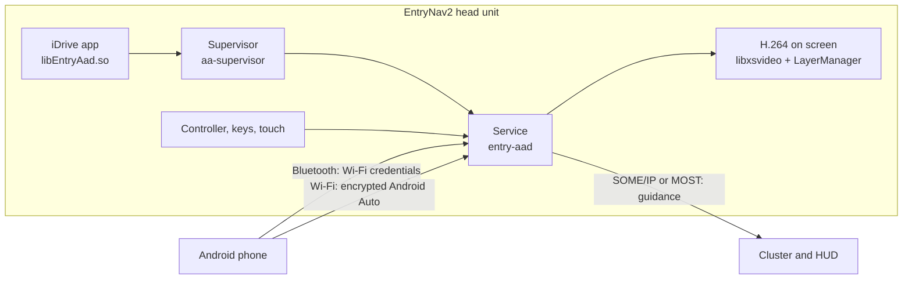

<div align="center">


# EntryNav2 (EntryEvo) Android Auto

**Android Auto in BMW iDrive on the EntryNav2 head unit, wireless or over USB.**<br>
No dongle, no BMW file replaced, and updates from a USB stick.

[](https://github.com/Jiraiya43/EntryNav2-Android-Auto/actions/workflows/ci.yml)
[](https://github.com/Jiraiya43/EntryNav2-Android-Auto/releases)
[](https://github.com/Jiraiya43/EntryNav2-Android-Auto/releases)
[](LICENSE.md)

English · [Français](README.fr.md)

[Quick start](#quick-start) · [Compatible cars](#compatible-cars) · [Installation guide](docs/INSTALLATION.en.md) ·
[FAQ](#faq) · [Changelog](CHANGELOG.en.md)

</div>

> [!WARNING]
> This is experimental software that writes to your car's head unit. It is developed on **one car**; owners of about
> twenty others report what they saw ([list](docs/COMPATIBILITE.md), in French), and nothing guarantees that it works on
> yours. Read [Status](#status) and the [disclaimer](#licence-and-disclaimer) first. It is not affiliated with BMW or
> Google.

## Features

<table>
<tr>
<td width="50%" valign="top">

**📶 Wireless or USB**<br>
The phone pairs over Bluetooth, then joins the car's own Wi-Fi, the one CarPlay uses. Phones without wireless Android
Auto use a USB cable (experimental, off by default): a box in the menu picks the cable or wireless, nothing is
guessed. [Setup and limits](docs/USB.md) (in French).

</td>
<td width="50%" valign="top">

**🎛️ The car's own controls**<br>
iDrive controller, hard keys, touch screen and steering wheel buttons. NAV, MAP, MEDIA and COM open Android Auto's
apps. The car's microphone serves the Assistant, which starts from Android Auto's microphone button; the steering
wheel voice button stays with iDrive.

</td>
</tr>
<tr>
<td valign="top">

**🧭 Guidance in the cluster and head-up display**<br>
Arrow, distance, street name and roundabout exit on G-series cars; F-series cars are being tried
([compatibility](docs/COMPATIBILITE.md#flèches-sur-le-compteur-des-série-f)). The car's GPS is sent to the phone, with
a fallback to the phone's own.

</td>
<td valign="top">

**🔄 Updates from a USB stick**<br>
After the first installation over SSH, newer versions install from a USB stick through the Android Auto menu, without
a PC (from 0.13.0-rc.10). Only an archive signed by the project is accepted
([updating](docs/INSTALLATION.en.md#from-a-usb-stick-without-a-pc)).

</td>
</tr>
<tr>
<td valign="top">

**🚗 Lives alongside iDrive**<br>
Started from an *Android Auto* entry in the Media menu, with its own menu. Reversing camera, park assist, volume
overlay, driving modes, phone calls, day and night: iDrive keeps its screens, Android Auto comes back after them.

</td>
<td valign="top">

**↩️ Always reversible**<br>
Two folders are added, no BMW file is replaced. Bluetooth goes back to iDrive when Android Auto stops, and a guard
switches the app off if iDrive crashes several times in a row after loading it.

</td>
</tr>
</table>

## Quick start

1. **Check your car.** It needs an EntryNav2 head unit, a 1280×480, 800×480 or 1440×540 screen, and the root
   password; see [Requirements](#requirements).
2. **Download** the latest archive from [Releases](https://github.com/Jiraiya43/EntryNav2-Android-Auto/releases).
3. **Install once over SSH**, following the [installation guide](docs/INSTALLATION.en.md). Its step 2 checks the car
   without writing anything.
4. **Start**: on iDrive, *Media*, *Android Auto*, *Start Android Auto*, then accept the car on the phone.
5. **Update later from a USB stick**: copy the new archive onto it, then *Update from USB stick* in the menu.

## Status

| | |
|---|---|
| Latest release | [0.12.0](https://github.com/Jiraiya43/EntryNav2-Android-Auto/releases/latest), tried in a car (pre-1.0: expect rough edges); newer [pre-releases](https://github.com/Jiraiya43/EntryNav2-Android-Auto/releases) are being tried |
| Tried in a car | the reference car, a 2019 BMW G20 (iDrive software `202111011321`) |
| Other cars | about twenty, reported by their owners ([below](#compatible-cars)); a compatibility check is built in |
| Next | 1.0: the [roadmap](ROADMAP.md) says what is left |

Every change is tested on a PC, and the ARM programs run under QEMU against the car's own libraries. Only a car test
counts as proof: [CHANGELOG.en.md](CHANGELOG.en.md) says for each version whether it was tried in a car or only tested
on a PC. The [French changelog](CHANGELOG.md) is the authoritative version.

## Compatible cars

Reported working by their owners, wireless, over USB or both:

| | Models |
|---|---|
| **G series** | 3 Series G20 and G21, 5 Series G30, X3 G01 |
| **F series** | 1 Series F20, F21, F40 and F52; 2 Series F44 and F45; 3 Series F30; X1 F48 |
| **i and MINI** | i3; MINI Clubman F54, MINI F56 and F57 |

Each car, with its iDrive software, screen, link and the version tried, is in
[docs/COMPATIBILITE.md](docs/COMPATIBILITE.md#voitures-essayées) (in French). Not listed? The check of the
installation's step 2 changes nothing on the car, and a
[compatibility report](https://github.com/Jiraiya43/EntryNav2-Android-Auto/issues/new/choose) with its result helps
the most.

## Requirements

- A BMW or MINI with an **EntryNav2** head unit (called *EntryEVO* inside its system), with a **1280×480**, **800×480**
  or **1440×540** screen ([screens](docs/COMPATIBILITE.md#autres-tailles-décran)). Wireless needs the unit's
  **CarPlay Wi-Fi**; without it, a [USB cable](docs/USB.md) works too.
  NBT Evo, ID7 and MGU units run other systems: this project cannot run on them.
- For the first installation, a PC with an SSH client (Windows 10/11, Linux or macOS) and an **ENET cable** (OBD to
  Ethernet). Later updates install from a USB stick.
- The head unit's **root password**. It is not provided with this project.
- An Android phone with Android Auto.

## Installing

Installation is a short manual procedure over SSH, described step by step in
[docs/INSTALLATION.en.md](docs/INSTALLATION.en.md) ([French](docs/INSTALLATION.md)):

1. Download `entrynav2-android-auto-<version>-armhf.tar` from [Releases](https://github.com/Jiraiya43/EntryNav2-Android-Auto/releases) and check
   its SHA-256.
2. Copy it to the head unit's `/tmp` with `scp`.
3. **Check the car**: nothing is written. The unit's own loader confirms every library and function the programs need,
   and `aa-supervisor --compat` rehearses the startup of Android Auto.
4. **Install**: the system is remounted read-write only while two folders are copied (`/opt/aa` and
   `/opt/hmi/data/ro/Plugins/EntryAad`), then the unit restarts.
5. On iDrive: *Media*, *Android Auto*, *Start Android Auto*.

After that, newer versions install without a PC: the archive copied as is onto a USB stick, then *Update from USB
stick* in the Android Auto menu. Only an archive signed by the project is accepted, everything is checked before
anything is written, and an update cut by a power failure is finished by the next one
([updating](docs/INSTALLATION.en.md#updating)).

Settings and logs live in `/var/local/data/AA` ([docs/MAINTENANCE.md](docs/MAINTENANCE.md)). Uninstalling removes the two
folders.

## FAQ

<details>
<summary><b>Does it work on NBT Evo, ID7 or MGU (iDrive 7)?</b></summary>

No. Those head units run other systems, and this project only runs on the EntryNav2 (EntryEVO). For NBT Evo, see
[Supra-iDrive6-Android-Auto](https://github.com/Sq00ky/Supra-iDrive6-Android-Auto), the project this one started from.

</details>

<details>
<summary><b>How do I open SSH on my head unit?</b></summary>

The project has no tool for it. Some online services sell the unlock, usually for a small price.

</details>

<details>
<summary><b>Wireless lags or stutters. What can I do?</b></summary>

Most reports so far came from the phone's side. Update Android Auto and Google Play services first: a stutter on
Samsung phones with One UI 9 went away with an Android Auto update
([#26](https://github.com/Jiraiya43/EntryNav2-Android-Auto/issues/26)). Then compare with the USB cable, and open an
issue with the logs (see below): the `[WifiLink]` lines show the link's round trip and the phone's silences.

</details>

<details>
<summary><b>The phone never starts Android Auto wirelessly.</b></summary>

Pair the phone again while Android Auto is running (*Start Android Auto* first): a phone paired while the service was
not running keeps a list of the car's services without Android Auto
([#72](https://github.com/Jiraiya43/EntryNav2-Android-Auto/issues/72)). A VPN or ad blocker on the phone also stopped
it on one car ([#137](https://github.com/Jiraiya43/EntryNav2-Android-Auto/issues/137)).

</details>

<details>
<summary><b>Where does the sound go?</b></summary>

Through the car's Bluetooth audio, like any paired phone: pick the phone's Bluetooth source in iDrive if it does not
come by itself. Sound over Wi-Fi is not done yet ([roadmap](ROADMAP.md)).

</details>

<details>
<summary><b>How do I send logs?</b></summary>

In the Android Auto menu, tick *Keep logs*, reproduce the problem, then press *Copy logs to USB stick* and attach the
archive to an [issue](https://github.com/Jiraiya43/EntryNav2-Android-Auto/issues/new/choose). Never post a password,
your VIN, or photos that carry their location.

</details>

<details>
<summary><b>Does it cost anything?</b></summary>

No. It is free and will stay free; the Help page of its menu says so too. See
[Supporting the project](#supporting-the-project) if you want to give something back.

</details>

## How it works



1. The iDrive app starts the supervisor, which borrows a Bluetooth slot and switches the car's Wi-Fi on.
2. The service sends the Wi-Fi credentials to the phone over Bluetooth; the phone connects back over Wi-Fi with TLS.
3. The service describes the car, decodes the phone's H.264 video with the unit's hardware decoder and shows it in its
   own LayerManager layer.
4. Input, GPS, day and night, microphone and guidance each travel on their own channel.

Details in [docs/ARCHITECTURE.md](docs/ARCHITECTURE.md).

## Building from source

You need Linux or WSL with Docker, and for the ARM build **a copy of the car's system** in `~/entrynav2/rootfs`
(`HU_ROOTFS` to change it). That copy holds BMW files: it never goes into git. PC tests and the optional link-only ARM
SDK below do not need it.

```sh
make check                                              # style, content checks, PC tests: what CI runs
docker build -t entrynav2-tc:4.7 toolchain              # once: GCC 4.7 for ARMv7 hard-float
bash toolchain/tc.sh make -j4 all hmiapp test-arm-all   # ARM programs, linked against the car's libraries
python3 -I tests/run_qemu.py                            # ARM tests under QEMU with the car's libraries
make verify_binary verify_wireless                      # record the programs that passed
python3 tools/package_release.py --unsigned             # artifacts/entrynav2-android-auto-<version>-armhf.tar
```

For an **opt-in build without a car system**, build the base image above, then:

```sh
docker build -f toolchain/Dockerfile.sdk -t entrynav2-sdk:4.7 toolchain
bash toolchain/tc.sh --sdk make -j4 all                # isolated outputs in artifacts/sdk/
python3 tools/verify_sdk.py                            # static ELF and plugin descriptor checks
python3 -m unittest discover -s tests -p test_sdk.py   # verifier tests; needs pyelftools
python3 -m unittest discover -s tests -p test_sdk_artifact.py  # needs the SDK build
```

The SDK uses open-source ARM libraries and link-only stubs; the output still needs the real car libraries to run.
The checks need pyelftools and readelf and never execute these stubs. They cannot validate BMW vtables, callbacks or
hardware behavior. This build is not release-validated: the existing car-library QEMU checks and release workflow use
the firmware build. SDK outputs cannot replace a car test.

See [CONTRIBUTING.md](CONTRIBUTING.md) for the full test list and the project's rules.

## Repository layout

```text
core/        Android Auto protocol: session, TLS, Bluetooth-to-Wi-Fi handshake, car description
platform/    everything specific to EntryNav2: video, layers, input, GPS, microphone, Wi-Fi, cluster
hmiapp/      the iDrive app loaded by HmiMain3D
tools/       supervisor, release packaging and checks
tests/       PC tests and ARM tests under QEMU
toolchain/   Docker image of the cross compiler
docs/        documentation (French; the installation guide also in English)
```

## Contributing

Bug reports, compatibility reports from other cars and pull requests are welcome: see
[CONTRIBUTING.md](CONTRIBUTING.md) and the [code of conduct](CODE_OF_CONDUCT.md). A compatibility report (the check of
the installation's step 2) changes nothing on the car and helps the most. Security issues: see
[SECURITY.md](SECURITY.md).

## Supporting the project

This project is free and stays free; nothing is expected in return. If you want to support it, you can do so through
[GitHub Sponsors](https://github.com/sponsors/Jiraiya43). Support will go towards fitting an MGU head unit (iDrive 7)
to my G20 and offering open-source apps for iDrive 7.

## Credits

This project started as a port of [Supra-iDrive6-Android-Auto](https://github.com/Sq00ky/Supra-iDrive6-Android-Auto) by
Sq00ky, then was reworked and extended for the EntryNav2. Thanks to Sq00ky for that work, and to everyone who tried it
in their car, reported back or sent a pull request.

## Licence and disclaimer

© 2026 Jiraiya43, under the [PolyForm Noncommercial License 1.0.0](LICENSE.md): any noncommercial use, including
modifying and sharing, as long as the licence goes with every copy. Commercial use is not allowed.

The software comes as is, without any warranty. Installing it modifies the head unit's system and may affect your
warranty. Use it only on a car you own or with its owner's consent, with the car parked during installation, and
never operate the head unit's shell while driving.

BMW and iDrive are trademarks of BMW AG; Android and Android Auto are trademarks of Google LLC. This project is not
affiliated with, endorsed or sponsored by either.
